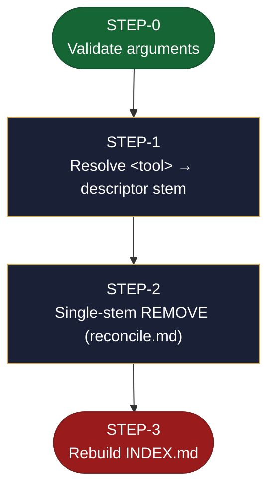

<!-- generated — do not edit; source: canonical/skills/aid-unset-connector/SKILL.md -->

## Frontmatter

- **`name`** — aid-unset-connector
- **`description`** — Remove a connector to a tracker or tool. Use when a connection is no longer wanted.
- **`allowed-tools`** — Read Bash Shell Terminal
- **`argument-hint`** — &lt;tool>  -- e.g. aid-unset-connector Jira

[Definition: `canonical/skills/aid-unset-connector/SKILL.md`](https://github.com/AndreVianna/aid-methodology/blob/master/canonical/skills/aid-unset-connector/SKILL.md)

## Flow

> **Approximate:** This chart is derived by heuristic; exact transitions may differ from runtime behaviour.

## Source fragments

Every node in the chart above, in chart order, with the exact `canonical/` text it was derived from.

**1 · `STEP-0`** — Validate arguments · _entry_

~~~~plaintext title="canonical/skills/aid-unset-connector/SKILL.md#L34" wrap
### Step 0: Validate arguments
~~~~

[Source: `canonical/skills/aid-unset-connector/SKILL.md#L34`](https://github.com/AndreVianna/aid-methodology/blob/master/canonical/skills/aid-unset-connector/SKILL.md#L34)

**2 · `STEP-1`** — Resolve &lt;tool> → descriptor stem · _step_

~~~~plaintext title="canonical/skills/aid-unset-connector/SKILL.md#L53" wrap
## Step 1: Resolve `<tool>` → descriptor stem
~~~~

[Source: `canonical/skills/aid-unset-connector/SKILL.md#L53`](https://github.com/AndreVianna/aid-methodology/blob/master/canonical/skills/aid-unset-connector/SKILL.md#L53)

**3 · `STEP-2`** — Single-stem REMOVE (reconcile.md) · _step_

~~~~plaintext title="canonical/skills/aid-unset-connector/SKILL.md#L67" wrap
## Step 2: Single-stem REMOVE (`reconcile.md`)
~~~~

[Source: `canonical/skills/aid-unset-connector/SKILL.md#L67`](https://github.com/AndreVianna/aid-methodology/blob/master/canonical/skills/aid-unset-connector/SKILL.md#L67)

**4 · `STEP-3`** — Rebuild INDEX.md · _exit_ · UNSPECIFIED

~~~~plaintext title="canonical/skills/aid-unset-connector/SKILL.md#L97" wrap
## Step 3: Rebuild `INDEX.md`
~~~~

[Source: `canonical/skills/aid-unset-connector/SKILL.md#L97`](https://github.com/AndreVianna/aid-methodology/blob/master/canonical/skills/aid-unset-connector/SKILL.md#L97)
