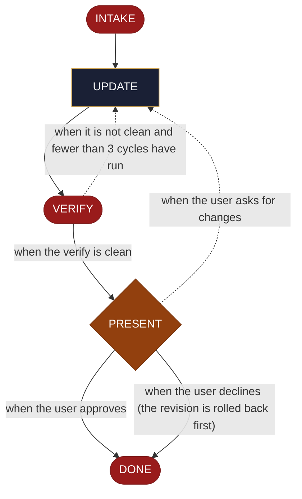

<!-- generated — do not edit; source: canonical/skills/aid-update-architecture/SKILL.md -->

## Frontmatter

- **`name`** — aid-update-architecture
- **`description`** — Revise the project's build-and-shape (C1) Knowledge Base document -- components and their responsibilities, boundaries, interactions, and the invariants a change must not break -- plus any previously created outputs you name. Use this skill when the architecture document already exists and part of it needs revising. Requires no design seed: the change you state in the run is a sufficient input. Reads and consumes an architecture seed when one is present in `.aid/design/`. When the C1 document does not yet exist, routes to `/aid-create-architecture`. To write documentation ABOUT an architecture rather than revise the KB record, use `/aid-document-architecture`. Produced by the aid-architect agent and independently verified by aid-reviewer (full verify). Allocates a work-NNN folder.
- **`allowed-tools`** — Read Glob Grep Bash Shell Terminal Write Edit Agent
- **`argument-hint`** — &lt;change> -- what to revise in the architecture record

[Definition: `canonical/skills/aid-update-architecture/SKILL.md`](https://github.com/AndreVianna/aid-methodology/blob/master/canonical/skills/aid-update-architecture/SKILL.md)

## Flow

## Source fragments

Every node in the chart above, in chart order, with the exact `canonical/` text it was derived from.

**1 · `INTAKE`** · _exit_ · HALT

~~~~plaintext title="canonical/skills/aid-update-architecture/SKILL.md#L51-L76" wrap
## State: INTAKE

1. **Require a stated change.** Empty argument -> ask one bootstrapping question ("What
   should change in the architecture record?") and wait.
2. **No seed is required.** The change stated in this run is a sufficient input, and this
   skill completes without a seed. **Read and consume one when present** at
   `.aid/design/architecture.md`, carrying its `## Current direction` into the destination and
   deleting it once realized.
3. **Resolve the destination by concern.** This skill binds concern **C1** (build & shape).
   Where a seed supplied a `## Destination`, use it; otherwise apply the concern rule here --
   resolve C1 against `.aid/settings.yml` `knowledge.doc_set`, falling back to the C1 row of
   `.aid/runtime/templates/kb-authoring/domain-doc-matrix.md` -- and **confirm the resolution
   with the user before writing**. Never resolve silently. C1's default set holds both
   `project-structure.md` and `architecture.md`; this skill targets the document describing
   the system's shape, never `project-structure.md`.
4. **Read the whole destination**, and note its `source:` field. Absent destination -> allocate nothing and
   write nothing: tell the user to run `/aid-create-architecture`, and end the run.
5. **Ask, every run, which derived outputs to update alongside this one.** This question is
   unconditional -- it is asked on every invocation, and the answer is **stored nowhere** but this
   run's step detail: no frontmatter backlink, no manifest, no registry, and no state carried
   between runs. The question is asked afresh each time, and UPDATE applies the answer.
6. **Classify complexity** for the `aid-architect` dispatch (verifier tier >= producer).
7. **Allocate** once the destination is present, so a route leaves no work behind. Go through the Work
   Initiation Gate exactly as the contract's Allocation rule requires
   (`.aid/runtime/templates/work-initiation-gate.md` § 3a is the shape), with
   `initiator: aid-update-architecture`, saved step `UPDATE` (INTAKE runs before the record and saves nothing), and `--seed .aid/design/architecture.md` on the gate's `--create` when that seed exists (the gate adds it to the work's `sources:` and copies its `## Questions` into the work's record). `phase` is not driven.
~~~~

[Source: `canonical/skills/aid-update-architecture/SKILL.md#L51-L76`](https://github.com/AndreVianna/aid-methodology/blob/master/canonical/skills/aid-update-architecture/SKILL.md#L51-L76) · [full step: `canonical/skills/aid-update-architecture/SKILL.md#L51-L81`](https://github.com/AndreVianna/aid-methodology/blob/master/canonical/skills/aid-update-architecture/SKILL.md#L51-L81)

**2 · `UPDATE`** · _step_

~~~~plaintext title="canonical/skills/aid-update-architecture/SKILL.md#L85-L91" wrap
## State: UPDATE

**Before the first edit,** copy every file this step will edit or delete (the destination, each output the user
named in INTAKE, a consumed seed and, for a promotion, `tech-debt.md`) into `rollback/` in the work folder, under the same
relative path, so PRESENT can restore them if the user declines. Copy only once: when UPDATE runs
again (after VERIFY or a requested change), a file already under `rollback/` is kept, so a decline restores
the original, not an earlier revision.
~~~~

[Source: `canonical/skills/aid-update-architecture/SKILL.md#L85-L91`](https://github.com/AndreVianna/aid-methodology/blob/master/canonical/skills/aid-update-architecture/SKILL.md#L85-L91) · [full step: `canonical/skills/aid-update-architecture/SKILL.md#L85-L100`](https://github.com/AndreVianna/aid-methodology/blob/master/canonical/skills/aid-update-architecture/SKILL.md#L85-L100)

**3 · `VERIFY`** · _exit_ · HALT

~~~~plaintext title="canonical/skills/aid-update-architecture/SKILL.md#L104-L107" wrap
## State: VERIFY

**Full verify**, as `design-lifecycle.md` defines it. Not clean -> loop to UPDATE; the
3-cycle circuit breaker there escalates to IMPEDIMENT + `lifecycle: Blocked`.
~~~~

[Source: `canonical/skills/aid-update-architecture/SKILL.md#L104-L107`](https://github.com/AndreVianna/aid-methodology/blob/master/canonical/skills/aid-update-architecture/SKILL.md#L104-L107) · [full step: `canonical/skills/aid-update-architecture/SKILL.md#L104-L109`](https://github.com/AndreVianna/aid-methodology/blob/master/canonical/skills/aid-update-architecture/SKILL.md#L104-L109)

**4 · `PRESENT`** — hard stop -- the user decides · _decision_

~~~~plaintext title="canonical/skills/aid-update-architecture/SKILL.md#L113-L115" wrap
## State: PRESENT (hard stop -- the user decides)

Present the revision, name every output touched, and assert that a consumed seed is gone.
~~~~

[Source: `canonical/skills/aid-update-architecture/SKILL.md#L113-L115`](https://github.com/AndreVianna/aid-methodology/blob/master/canonical/skills/aid-update-architecture/SKILL.md#L113-L115) · [full step: `canonical/skills/aid-update-architecture/SKILL.md#L113-L128`](https://github.com/AndreVianna/aid-methodology/blob/master/canonical/skills/aid-update-architecture/SKILL.md#L113-L128)

**5 · `DONE`** · _exit_ · HALT

~~~~plaintext title="canonical/skills/aid-update-architecture/SKILL.md#L132-L134" wrap
## State: DONE

Set `lifecycle` to `Completed` through the writer (`--pipeline --field Lifecycle --value Completed`), which also clears the saved skill and step.
~~~~

[Source: `canonical/skills/aid-update-architecture/SKILL.md#L132-L134`](https://github.com/AndreVianna/aid-methodology/blob/master/canonical/skills/aid-update-architecture/SKILL.md#L132-L134) · [full step: `canonical/skills/aid-update-architecture/SKILL.md#L132-L136`](https://github.com/AndreVianna/aid-methodology/blob/master/canonical/skills/aid-update-architecture/SKILL.md#L132-L136)
