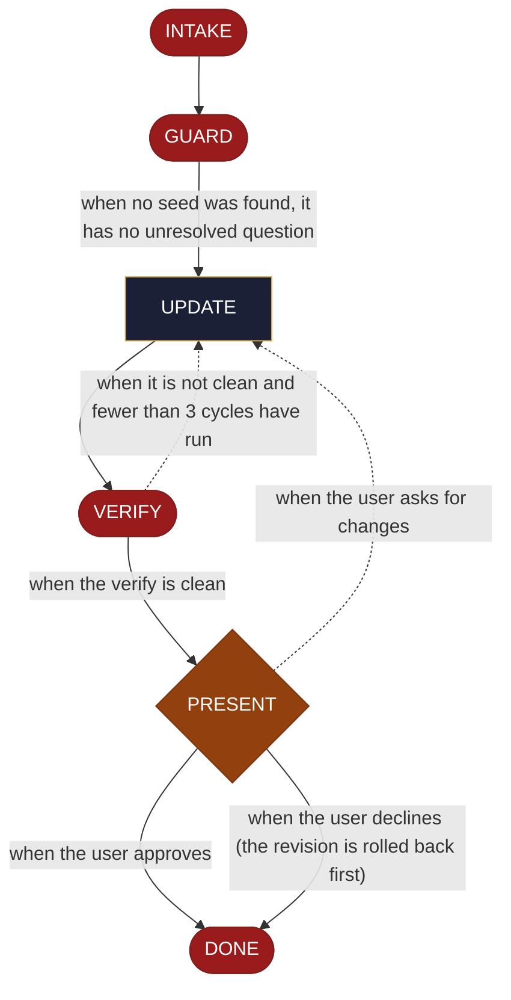

<!-- generated — do not edit; source: canonical/skills/aid-update-backlog/SKILL.md -->

## Frontmatter

- **`name`** — aid-update-backlog
- **`description`** — Revise backlog.md -- re-prioritize items, add new items, and promote accepted tech-debt.md rows into backlog.md (deleted from tech-debt.md in the same run). Use this skill when the backlog already exists and items need adding, re-grouping, or retiring. Keeps ## Next Release in step with what is actually committed. Reads and consumes a backlog seed when one is present in `.aid/design/`; never requires one. Asks every run which previously created outputs to update alongside it -- no stored list, no tracking metadata written. When backlog.md is absent, routes to `/aid-create-backlog` without writing anything.
- **`allowed-tools`** — Read Glob Grep Bash Shell Terminal Write Edit Agent
- **`argument-hint`** — [&lt;change>] -- what to revise (items to add, re-prioritize, promote, or move)

[Definition: `canonical/skills/aid-update-backlog/SKILL.md`](https://github.com/AndreVianna/aid-methodology/blob/master/canonical/skills/aid-update-backlog/SKILL.md)

## Flow

## Source fragments

Every node in the chart above, in chart order, with the exact `canonical/` text it was derived from.

**1 · `INTAKE`** · _exit_ · HALT

~~~~plaintext title="canonical/skills/aid-update-backlog/SKILL.md#L45-L47" wrap
## State: INTAKE

Every question this step asks (the opening and the derived-outputs question) is asked before the work exists, so each is recorded in a design document, as the gate's "Recording the questions asked before a work exists" says (`.aid/runtime/templates/work-initiation-gate.md`): `bash .aid/runtime/scripts/execute/writeback-state.sh --ask --design <file> --category <category> --impact <High|Medium|Low> --context '<the question, as shown>' --suggested '<your recommendation>' --asked-by aid-update-backlog` before it is shown (it prints the question's id), then `--answer --design <file> --id <the printed id> --state Answered|Skipped|Assumed --value '<the reply>'` after the reply. `<file>` is `.aid/design/backlog.md` when that seed exists, otherwise `.aid/design/untitled-<YYYYMMDD-HHMMSS>.md`, stamped at the first question and reused for the whole run. A question recorded in the seed leaves the rest of the seed untouched.
~~~~

[Source: `canonical/skills/aid-update-backlog/SKILL.md#L45-L47`](https://github.com/AndreVianna/aid-methodology/blob/master/canonical/skills/aid-update-backlog/SKILL.md#L45-L47) · [full step: `canonical/skills/aid-update-backlog/SKILL.md#L45-L72`](https://github.com/AndreVianna/aid-methodology/blob/master/canonical/skills/aid-update-backlog/SKILL.md#L45-L72)

**2 · `GUARD`** · _exit_ · HALT

~~~~plaintext title="canonical/skills/aid-update-backlog/SKILL.md#L76-L79" wrap
## State: GUARD

**Readiness gate (class-1 contract, feature-002 §3b).** Only applies when a seed was
found in INTAKE.
~~~~

[Source: `canonical/skills/aid-update-backlog/SKILL.md#L76-L79`](https://github.com/AndreVianna/aid-methodology/blob/master/canonical/skills/aid-update-backlog/SKILL.md#L76-L79) · [full step: `canonical/skills/aid-update-backlog/SKILL.md#L76-L89`](https://github.com/AndreVianna/aid-methodology/blob/master/canonical/skills/aid-update-backlog/SKILL.md#L76-L89)

**3 · `UPDATE`** · _step_

~~~~plaintext title="canonical/skills/aid-update-backlog/SKILL.md#L93-L99" wrap
## State: UPDATE

**Before the first edit,** copy every file this step will edit or delete (the destination, each output the user
named in INTAKE, a consumed seed and, for a promotion, `tech-debt.md`) into `rollback/` in the work folder, under the same
relative path, so PRESENT can restore them if the user declines. Copy only once: when UPDATE runs
again (after VERIFY or a requested change), a file already under `rollback/` is kept, so a decline restores
the original, not an earlier revision.
~~~~

[Source: `canonical/skills/aid-update-backlog/SKILL.md#L93-L99`](https://github.com/AndreVianna/aid-methodology/blob/master/canonical/skills/aid-update-backlog/SKILL.md#L93-L99) · [full step: `canonical/skills/aid-update-backlog/SKILL.md#L93-L171`](https://github.com/AndreVianna/aid-methodology/blob/master/canonical/skills/aid-update-backlog/SKILL.md#L93-L171)

**4 · `VERIFY`** · _exit_ · HALT

~~~~plaintext title="canonical/skills/aid-update-backlog/SKILL.md#L175-L179" wrap
## State: VERIFY

**Full verify** -- exactly as `design-lifecycle.md § Skill shape -- "Full verify"`
defines it. Not clean -> loop to UPDATE; the circuit-breaker there governs escalation
to IMPEDIMENT + `lifecycle: Blocked`.
~~~~

[Source: `canonical/skills/aid-update-backlog/SKILL.md#L175-L179`](https://github.com/AndreVianna/aid-methodology/blob/master/canonical/skills/aid-update-backlog/SKILL.md#L175-L179) · [full step: `canonical/skills/aid-update-backlog/SKILL.md#L175-L181`](https://github.com/AndreVianna/aid-methodology/blob/master/canonical/skills/aid-update-backlog/SKILL.md#L175-L181)

**5 · `PRESENT`** — hard stop -- the user decides · _decision_

~~~~plaintext title="canonical/skills/aid-update-backlog/SKILL.md#L185-L187" wrap
## State: PRESENT (hard stop -- the user decides)

Present the revised document clearly. Assert:
~~~~

[Source: `canonical/skills/aid-update-backlog/SKILL.md#L185-L187`](https://github.com/AndreVianna/aid-methodology/blob/master/canonical/skills/aid-update-backlog/SKILL.md#L185-L187) · [full step: `canonical/skills/aid-update-backlog/SKILL.md#L185-L207`](https://github.com/AndreVianna/aid-methodology/blob/master/canonical/skills/aid-update-backlog/SKILL.md#L185-L207)

**6 · `DONE`** · _exit_ · HALT

~~~~plaintext title="canonical/skills/aid-update-backlog/SKILL.md#L211-L213" wrap
## State: DONE

Set `lifecycle` to `Completed` through the writer (`--pipeline --field Lifecycle --value Completed`), which also clears the saved skill and step.
~~~~

[Source: `canonical/skills/aid-update-backlog/SKILL.md#L211-L213`](https://github.com/AndreVianna/aid-methodology/blob/master/canonical/skills/aid-update-backlog/SKILL.md#L211-L213) · [full step: `canonical/skills/aid-update-backlog/SKILL.md#L211-L215`](https://github.com/AndreVianna/aid-methodology/blob/master/canonical/skills/aid-update-backlog/SKILL.md#L211-L215)
