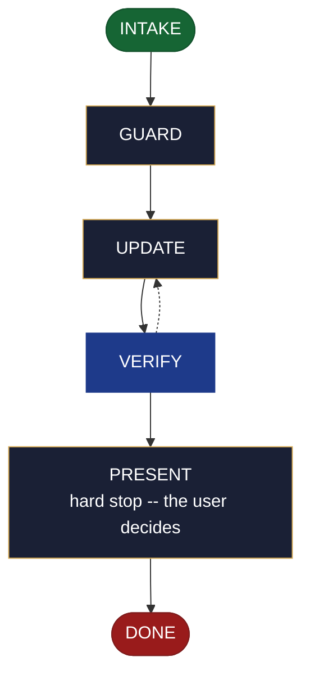

<!-- generated — do not edit; source: canonical/skills/aid-update-backlog/SKILL.md -->

## Frontmatter

- **`name`** — aid-update-backlog
- **`description`** — Revise backlog.md: reprioritize, add or retire items. Use when the backlog exists and has changed.
- **`allowed-tools`** — Read Glob Grep Bash Shell Terminal Write Edit Agent
- **`argument-hint`** — [&lt;change>] -- what to revise (items to add, re-prioritize, promote, or move)

[Definition: `canonical/skills/aid-update-backlog/SKILL.md`](https://github.com/AndreVianna/aid-methodology/blob/master/canonical/skills/aid-update-backlog/SKILL.md)

## Flow

## Source fragments

Every node in the chart above, in chart order, with the exact `canonical/` text it was derived from.

**1 · `INTAKE`** · _entry_

~~~~plaintext title="canonical/skills/aid-update-backlog/SKILL.md#L27-L48" wrap
## State: INTAKE

1. **Require a subject.** Empty argument -> ask one bootstrapping question ("What would
   you like to revise in the backlog -- items to add, re-prioritize, promote from
   tech-debt.md, or move between sections?") and wait.
2. **Allocate, exactly per `design-lifecycle.md § Skill shape -- Allocation`** -- the
   Work Initiation Gate, then `initiator: aid-update-backlog`, `active_skill:
   aid-update-backlog`, `pipeline.path: lite`, `lifecycle: Running`. `phase` is not
   driven.
3. **Read the destination** at `.aid/knowledge/backlog.md`. If absent, **route** to
   `/aid-create-backlog` -- name it explicitly in the response -- and write nothing.
   Set `lifecycle: Paused-Awaiting-Input`. Advance to DONE without proceeding further.
4. **Read the seed** at `.aid/design/backlog.md` if one exists. Note its presence or
   absence; do not require it.
5. **Read `tech-debt.md`** at `.aid/knowledge/tech-debt.md` if it exists. The seed or the
   user may name candidate rows to promote; know their current state before the confirm
   gate runs.
6. **Ask the derived-outputs question** -- every run, unconditionally: "Which previously
   created outputs should be updated alongside backlog.md?" Wait for the user's answer
   before proceeding. Write no stored list and no tracking metadata anywhere.
7. **Classify complexity (model + effort)** for the `aid-architect` dispatch below;
   verifier tier >= producer tier (`agent-dispatch-tiering.md`).
~~~~

[Source: `canonical/skills/aid-update-backlog/SKILL.md#L27-L48`](https://github.com/AndreVianna/aid-methodology/blob/master/canonical/skills/aid-update-backlog/SKILL.md#L27-L48) · [full step: `canonical/skills/aid-update-backlog/SKILL.md#L27-L50`](https://github.com/AndreVianna/aid-methodology/blob/master/canonical/skills/aid-update-backlog/SKILL.md#L27-L50)

**2 · `GUARD`** · _step_

~~~~plaintext title="canonical/skills/aid-update-backlog/SKILL.md#L54-L57" wrap
## State: GUARD

**Readiness gate (class-1 contract, feature-002 §3b).** Only applies when a seed was
found in INTAKE.
~~~~

[Source: `canonical/skills/aid-update-backlog/SKILL.md#L54-L57`](https://github.com/AndreVianna/aid-methodology/blob/master/canonical/skills/aid-update-backlog/SKILL.md#L54-L57) · [full step: `canonical/skills/aid-update-backlog/SKILL.md#L54-L66`](https://github.com/AndreVianna/aid-methodology/blob/master/canonical/skills/aid-update-backlog/SKILL.md#L54-L66)

**3 · `UPDATE`** · _step_

~~~~plaintext title="canonical/skills/aid-update-backlog/SKILL.md#L70-L72" wrap
## State: UPDATE

Dispatch **`aid-architect`** (clean context, tiered) to revise the document.
~~~~

[Source: `canonical/skills/aid-update-backlog/SKILL.md#L70-L72`](https://github.com/AndreVianna/aid-methodology/blob/master/canonical/skills/aid-update-backlog/SKILL.md#L70-L72) · [full step: `canonical/skills/aid-update-backlog/SKILL.md#L70-L142`](https://github.com/AndreVianna/aid-methodology/blob/master/canonical/skills/aid-update-backlog/SKILL.md#L70-L142)

**4 · `VERIFY`** · _loop-back_

~~~~plaintext title="canonical/skills/aid-update-backlog/SKILL.md#L146-L150" wrap
## State: VERIFY

**Full verify** -- exactly as `design-lifecycle.md § Skill shape -- "Full verify"`
defines it. Not clean -> loop to UPDATE; the circuit-breaker there governs escalation
to IMPEDIMENT + `lifecycle: Blocked`.
~~~~

[Source: `canonical/skills/aid-update-backlog/SKILL.md#L146-L150`](https://github.com/AndreVianna/aid-methodology/blob/master/canonical/skills/aid-update-backlog/SKILL.md#L146-L150) · [full step: `canonical/skills/aid-update-backlog/SKILL.md#L146-L152`](https://github.com/AndreVianna/aid-methodology/blob/master/canonical/skills/aid-update-backlog/SKILL.md#L146-L152)

**5 · `PRESENT`** — hard stop -- the user decides · _step_

~~~~plaintext title="canonical/skills/aid-update-backlog/SKILL.md#L156-L158" wrap
## State: PRESENT (hard stop -- the user decides)

Set `lifecycle: Paused-Awaiting-Input`. Present the revised document clearly. Assert:
~~~~

[Source: `canonical/skills/aid-update-backlog/SKILL.md#L156-L158`](https://github.com/AndreVianna/aid-methodology/blob/master/canonical/skills/aid-update-backlog/SKILL.md#L156-L158) · [full step: `canonical/skills/aid-update-backlog/SKILL.md#L156-L167`](https://github.com/AndreVianna/aid-methodology/blob/master/canonical/skills/aid-update-backlog/SKILL.md#L156-L167)

**6 · `DONE`** · _exit_ · UNSPECIFIED

~~~~plaintext title="canonical/skills/aid-update-backlog/SKILL.md#L171-L173" wrap
## State: DONE

Set `lifecycle: Completed`, `updated` now, append a `## Lifecycle History` row.
~~~~

[Source: `canonical/skills/aid-update-backlog/SKILL.md#L171-L173`](https://github.com/AndreVianna/aid-methodology/blob/master/canonical/skills/aid-update-backlog/SKILL.md#L171-L173) · [full step: `canonical/skills/aid-update-backlog/SKILL.md#L171-L173`](https://github.com/AndreVianna/aid-methodology/blob/master/canonical/skills/aid-update-backlog/SKILL.md#L171-L173)
