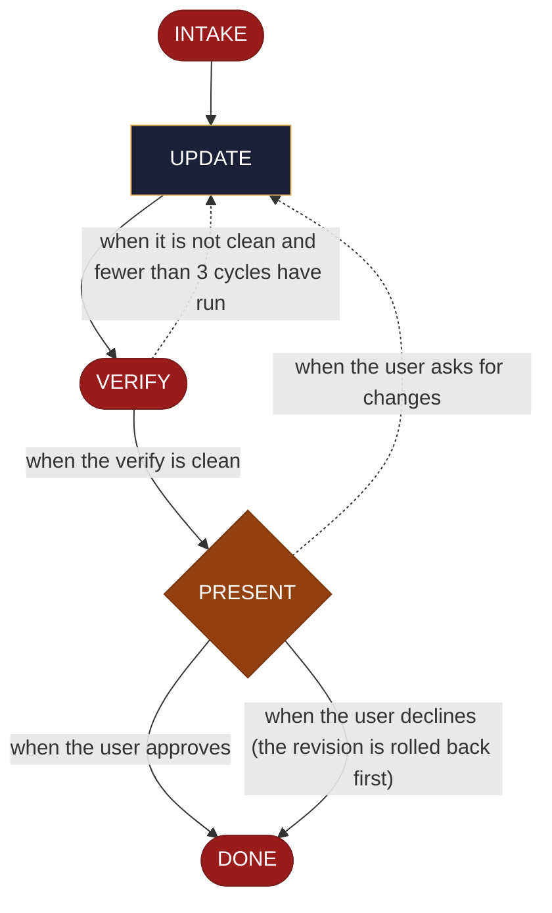

<!-- generated — do not edit; source: canonical/skills/aid-update-cicd/SKILL.md -->

## Frontmatter

- **`name`** — aid-update-cicd
- **`description`** — Revise the project's shipping (C8) Knowledge Base document -- pipeline stages and their order, triggers, environments and promotion, and the release flow -- plus any previously created outputs you name. Use this skill when the pipeline record already exists and a stage, trigger, environment or promotion rule has changed. Requires no design seed: the change you state in the run is a sufficient input. Reads and consumes a CI/CD seed when one is present in `.aid/design/`. When the C8 document does not yet exist, routes to `/aid-create-cicd`. To provision or change a resource the pipeline ships to, use `/aid-create-infra` or `/aid-update-infra`; to change a DATA pipeline rather than a delivery one, use `/aid-create-data-pipeline` or `/aid-update-data-pipeline`; to ship a built artifact now, use `/aid-deploy`. Produced by the aid-architect agent and independently verified by aid-reviewer (full verify). Allocates a work-NNN folder.
- **`allowed-tools`** — Read Glob Grep Bash Shell Terminal Write Edit Agent
- **`argument-hint`** — &lt;change> -- what to revise in the delivery-pipeline record

[Definition: `canonical/skills/aid-update-cicd/SKILL.md`](https://github.com/AndreVianna/aid-methodology/blob/master/canonical/skills/aid-update-cicd/SKILL.md)

## Flow

## Source fragments

Every node in the chart above, in chart order, with the exact `canonical/` text it was derived from.

**1 · `INTAKE`** · _exit_ · HALT

~~~~plaintext title="canonical/skills/aid-update-cicd/SKILL.md#L54-L56" wrap
## State: INTAKE

Every question this step asks (the opening, the destination confirmation, the production-config and the derived-outputs question) is asked before the work exists, so each is recorded in a design document, as the gate's "Recording the questions asked before a work exists" says (`.aid/runtime/templates/work-initiation-gate.md`): `bash .aid/runtime/scripts/execute/writeback-state.sh --ask --design <file> --category <category> --impact <High|Medium|Low> --context '<the question, as shown>' --suggested '<your recommendation>' --asked-by aid-update-cicd` before it is shown (it prints the question's id), then `--answer --design <file> --id <the printed id> --state Answered|Skipped|Assumed --value '<the reply>'` after the reply. `<file>` is `.aid/design/cicd.md` when that seed exists, otherwise `.aid/design/untitled-<YYYYMMDD-HHMMSS>.md`, stamped at the first question and reused for the whole run. A question recorded in the seed leaves the rest of the seed untouched.
~~~~

[Source: `canonical/skills/aid-update-cicd/SKILL.md#L54-L56`](https://github.com/AndreVianna/aid-methodology/blob/master/canonical/skills/aid-update-cicd/SKILL.md#L54-L56) · [full step: `canonical/skills/aid-update-cicd/SKILL.md#L54-L87`](https://github.com/AndreVianna/aid-methodology/blob/master/canonical/skills/aid-update-cicd/SKILL.md#L54-L87)

**2 · `UPDATE`** · _step_

~~~~plaintext title="canonical/skills/aid-update-cicd/SKILL.md#L91-L97" wrap
## State: UPDATE

**Before the first edit,** copy every file this step will edit or delete (the destination, each output the user
named in INTAKE, a consumed seed and, for a promotion, `tech-debt.md`) into `rollback/` in the work folder, under the same
relative path, so PRESENT can restore them if the user declines. Copy only once: when UPDATE runs
again (after VERIFY or a requested change), a file already under `rollback/` is kept, so a decline restores
the original, not an earlier revision.
~~~~

[Source: `canonical/skills/aid-update-cicd/SKILL.md#L91-L97`](https://github.com/AndreVianna/aid-methodology/blob/master/canonical/skills/aid-update-cicd/SKILL.md#L91-L97) · [full step: `canonical/skills/aid-update-cicd/SKILL.md#L91-L106`](https://github.com/AndreVianna/aid-methodology/blob/master/canonical/skills/aid-update-cicd/SKILL.md#L91-L106)

**3 · `VERIFY`** · _exit_ · HALT

~~~~plaintext title="canonical/skills/aid-update-cicd/SKILL.md#L110-L113" wrap
## State: VERIFY

**Full verify**, as `design-lifecycle.md` defines it. Not clean -> loop to UPDATE; the
3-cycle circuit breaker there escalates to IMPEDIMENT + `lifecycle: Blocked`.
~~~~

[Source: `canonical/skills/aid-update-cicd/SKILL.md#L110-L113`](https://github.com/AndreVianna/aid-methodology/blob/master/canonical/skills/aid-update-cicd/SKILL.md#L110-L113) · [full step: `canonical/skills/aid-update-cicd/SKILL.md#L110-L115`](https://github.com/AndreVianna/aid-methodology/blob/master/canonical/skills/aid-update-cicd/SKILL.md#L110-L115)

**4 · `PRESENT`** — hard stop -- the user decides · _decision_

~~~~plaintext title="canonical/skills/aid-update-cicd/SKILL.md#L119-L123" wrap
## State: PRESENT (hard stop -- the user decides)

Present the revision, say whether a workflow file was
touched and that it was asked for, name every output touched, and assert that a consumed seed
is gone.
~~~~

[Source: `canonical/skills/aid-update-cicd/SKILL.md#L119-L123`](https://github.com/AndreVianna/aid-methodology/blob/master/canonical/skills/aid-update-cicd/SKILL.md#L119-L123) · [full step: `canonical/skills/aid-update-cicd/SKILL.md#L119-L136`](https://github.com/AndreVianna/aid-methodology/blob/master/canonical/skills/aid-update-cicd/SKILL.md#L119-L136)

**5 · `DONE`** · _exit_ · HALT

~~~~plaintext title="canonical/skills/aid-update-cicd/SKILL.md#L140-L142" wrap
## State: DONE

Set `lifecycle` to `Completed` through the writer (`--pipeline --field Lifecycle --value Completed`), which also clears the saved skill and step.
~~~~

[Source: `canonical/skills/aid-update-cicd/SKILL.md#L140-L142`](https://github.com/AndreVianna/aid-methodology/blob/master/canonical/skills/aid-update-cicd/SKILL.md#L140-L142) · [full step: `canonical/skills/aid-update-cicd/SKILL.md#L140-L144`](https://github.com/AndreVianna/aid-methodology/blob/master/canonical/skills/aid-update-cicd/SKILL.md#L140-L144)
