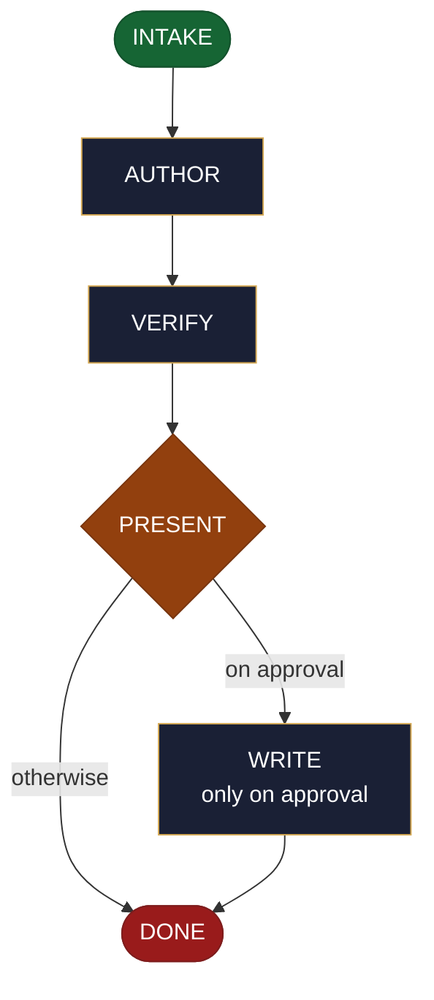

<!-- generated — do not edit; source: canonical/skills/aid-update-document/SKILL.md -->

## Frontmatter

- **`name`** — aid-update-document
- **`description`** — Revise or extend a document that already exists, in one pass. Use this skill when a document has drifted from the code, is missing a section, or needs a correction -- and you want the change drafted against the current source rather than written from memory. It reads the existing document first, then edits it, grounded in and accuracy-checked against the Knowledge Base (`.aid/knowledge/`) and the project source. It resolves nothing: it drafts the change and shows you a diff, and only after you approve is it written back. It never writes into `.aid/knowledge/` -- that is `/aid-update-kb`'s territory.
- **`allowed-tools`** — Read Glob Grep Bash Shell Terminal Write Edit Agent
- **`argument-hint`** — &lt;document + change> -- which existing document to update, and how

[Definition: `canonical/skills/aid-update-document/SKILL.md`](https://github.com/AndreVianna/aid-methodology/blob/master/canonical/skills/aid-update-document/SKILL.md)

## Flow

## Source fragments

Every node in the chart above, in chart order, with the exact `canonical/` text it was derived from.

**1 · `INTAKE`** · _entry_

~~~~plaintext title="canonical/skills/aid-update-document/SKILL.md#L39-L63" wrap
## State: INTAKE

1. **Require a target document + a change.** Empty argument -> ask one bootstrapping
   question ("Which document should I update, and what change?") and wait.
2. **Locate + read the existing document.** If it cannot be resolved, ask (or, if the user
   meant a new doc, suggest `/aid-create-document`).
3. **Pick the path** (fast if the document + change are clear; guided otherwise) and
   **classify complexity** -> `aid-tech-writer` model/effort (sonnet/medium default; opus/high
   for a large rewrite). Verifier tier >= producer.
4. **Allocate the work through the gate.** Run the Work Initiation Gate
   (`.aid/runtime/templates/work-initiation-gate.md`): `bash .aid/runtime/scripts/works/enumerate-works.sh`
   (main tree + every git worktree). Empty -> no prompt. Works exist -> ask the gate's
   new-vs-continuation question with the enumerated list.
   - **New work:** call the gate's `§ 3a` with the user's words, this skill's name
     (`aid-update-document`), its first step (`INTAKE`), and a kebab-case slug from the document.
     The gate's `§ 3a` step 2 creates and enters the worktree
     (`worktree-lifecycle.sh create <work-id> <name>`),
     **then** allocate (`.aid/works/<work-id>-<slug>/`) the work folder and write its record through
     the writer, before it hands back: "`STATE.yml` was created by the gate;
     skip any instruction to write `initiator`, `active_skill`, `lifecycle` or `phase` by hand;
     set other keys through the writer." This skill drives no `phase`.
   - **Continuation:** On continuation, follow the gate's § 3b: enter the chosen work's worktree and run the skill its record names, at its saved step.
5. **Read the design seed, if present.** If `.aid/design/document.md` exists, read it as
   prior context before drafting; it is an input, never a substitute, and is not modified
   by this run.
~~~~

[Source: `canonical/skills/aid-update-document/SKILL.md#L39-L63`](https://github.com/AndreVianna/aid-methodology/blob/master/canonical/skills/aid-update-document/SKILL.md#L39-L63) · [full step: `canonical/skills/aid-update-document/SKILL.md#L39-L65`](https://github.com/AndreVianna/aid-methodology/blob/master/canonical/skills/aid-update-document/SKILL.md#L39-L65)

**2 · `AUTHOR`** · _step_

~~~~plaintext title="canonical/skills/aid-update-document/SKILL.md#L69-L73" wrap
## State: AUTHOR

Dispatch **`aid-tech-writer`** (clean context, tiered) to produce the **revised** document
(a draft in the work folder, not yet written back), grounded in and accurate to the KB +
project source, preserving the document's existing genre structure.
~~~~

[Source: `canonical/skills/aid-update-document/SKILL.md#L69-L73`](https://github.com/AndreVianna/aid-methodology/blob/master/canonical/skills/aid-update-document/SKILL.md#L69-L73) · [full step: `canonical/skills/aid-update-document/SKILL.md#L69-L75`](https://github.com/AndreVianna/aid-methodology/blob/master/canonical/skills/aid-update-document/SKILL.md#L69-L75)

**3 · `VERIFY`** · _step_

~~~~plaintext title="canonical/skills/aid-update-document/SKILL.md#L79-L83" wrap
## State: VERIFY

Same as `/aid-create-document`: mechanical grounding check + a clean-context **`aid-reviewer`**
adversarial check (accurate, complete, no fabrication, structure preserved) -> `grade.sh`
-> loop on failure (3-cycle circuit-breaker -> IMPEDIMENT, and the lifecycle set to `Blocked` through the writer).
~~~~

[Source: `canonical/skills/aid-update-document/SKILL.md#L79-L83`](https://github.com/AndreVianna/aid-methodology/blob/master/canonical/skills/aid-update-document/SKILL.md#L79-L83) · [full step: `canonical/skills/aid-update-document/SKILL.md#L79-L85`](https://github.com/AndreVianna/aid-methodology/blob/master/canonical/skills/aid-update-document/SKILL.md#L79-L85)

**4 · `PRESENT`** — hard stop -- human final say · _decision_

~~~~plaintext title="canonical/skills/aid-update-document/SKILL.md#L89-L92" wrap
## State: PRESENT  (hard stop -- human final say)

The hard stop follows the ASK step of `skill-steps.md`. Present the revised document **as a diff against
the current file** + the target path. Await approval. Never writes `.aid/knowledge/`.
~~~~

[Source: `canonical/skills/aid-update-document/SKILL.md#L89-L92`](https://github.com/AndreVianna/aid-methodology/blob/master/canonical/skills/aid-update-document/SKILL.md#L89-L92) · [full step: `canonical/skills/aid-update-document/SKILL.md#L89-L94`](https://github.com/AndreVianna/aid-methodology/blob/master/canonical/skills/aid-update-document/SKILL.md#L89-L94)

**5 · `WRITE`** — only on approval · _step_

~~~~plaintext title="canonical/skills/aid-update-document/SKILL.md#L98-L101" wrap
## State: WRITE  (only on approval)

Write the revision back to the existing document (the diff was already reviewed at PRESENT).
Then optionally print handoffs (`/aid-update-kb`, `/aid-create*`, ...).
~~~~

[Source: `canonical/skills/aid-update-document/SKILL.md#L98-L101`](https://github.com/AndreVianna/aid-methodology/blob/master/canonical/skills/aid-update-document/SKILL.md#L98-L101) · [full step: `canonical/skills/aid-update-document/SKILL.md#L98-L103`](https://github.com/AndreVianna/aid-methodology/blob/master/canonical/skills/aid-update-document/SKILL.md#L98-L103)

**6 · `DONE`** · _exit_ · HALT

~~~~plaintext title="canonical/skills/aid-update-document/SKILL.md#L107-L109" wrap
## State: DONE

Finish through the writer: `bash .aid/runtime/scripts/execute/writeback-state.sh --pipeline --field Lifecycle --value Completed`, which also clears the saved skill and step.
~~~~

[Source: `canonical/skills/aid-update-document/SKILL.md#L107-L109`](https://github.com/AndreVianna/aid-methodology/blob/master/canonical/skills/aid-update-document/SKILL.md#L107-L109) · [full step: `canonical/skills/aid-update-document/SKILL.md#L107-L111`](https://github.com/AndreVianna/aid-methodology/blob/master/canonical/skills/aid-update-document/SKILL.md#L107-L111)
