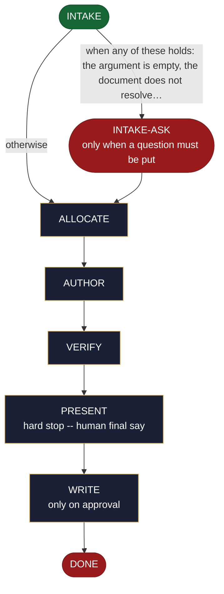

<!-- generated — do not edit; source: canonical/skills/aid-update-document/SKILL.md -->

## Frontmatter

- **`name`** — aid-update-document
- **`description`** — Revise or extend a document that already exists, in one pass. Use this skill when a document has drifted from the code, is missing a section, or needs a correction -- and you want the change drafted against the current source rather than written from memory. It reads the existing document first, then edits it, grounded in and accuracy-checked against the Knowledge Base (`.aid/knowledge/`) and the project source. It resolves nothing: it drafts the change and shows you a diff, and only after you approve is it written back. It never writes into `.aid/knowledge/` -- that is `/aid-update-kb`'s territory.
- **`allowed-tools`** — Read Glob Grep Bash Shell Terminal Write Edit Agent
- **`argument-hint`** — &lt;document + change> -- which existing document to update, and how

[Definition: `canonical/skills/aid-update-document/SKILL.md`](https://github.com/AndreVianna/aid-methodology/blob/master/canonical/skills/aid-update-document/SKILL.md)

## Flow

## Source fragments

Every node in the chart above, in chart order, with the exact `canonical/` text it was derived from.

**1 · `INTAKE`** · _entry_

~~~~plaintext title="canonical/skills/aid-update-document/SKILL.md#L39-L41" wrap
## State: INTAKE

INTAKE and INTAKE-ASK run before the work record exists, so they save no steps (`skill-steps.md`, § Before a work exists).
~~~~

[Source: `canonical/skills/aid-update-document/SKILL.md#L39-L41`](https://github.com/AndreVianna/aid-methodology/blob/master/canonical/skills/aid-update-document/SKILL.md#L39-L41) · [full step: `canonical/skills/aid-update-document/SKILL.md#L39-L55`](https://github.com/AndreVianna/aid-methodology/blob/master/canonical/skills/aid-update-document/SKILL.md#L39-L55)

**2 · `INTAKE-ASK`** — only when a question must be put · _exit_ · ASK

~~~~plaintext title="canonical/skills/aid-update-document/SKILL.md#L59-L61" wrap
## State: INTAKE-ASK  (only when a question must be put)

Ask one topic at a time, through the question protocol, in this order and only for what applies:
~~~~

[Source: `canonical/skills/aid-update-document/SKILL.md#L59-L61`](https://github.com/AndreVianna/aid-methodology/blob/master/canonical/skills/aid-update-document/SKILL.md#L59-L61) · [full step: `canonical/skills/aid-update-document/SKILL.md#L59-L71`](https://github.com/AndreVianna/aid-methodology/blob/master/canonical/skills/aid-update-document/SKILL.md#L59-L71)

**3 · `ALLOCATE`** · _step_

~~~~plaintext title="canonical/skills/aid-update-document/SKILL.md#L75-L78" wrap
## State: ALLOCATE

Allocate the work through the gate: the Work Initiation Gate
(`.aid/runtime/templates/work-initiation-gate.md`).
~~~~

[Source: `canonical/skills/aid-update-document/SKILL.md#L75-L78`](https://github.com/AndreVianna/aid-methodology/blob/master/canonical/skills/aid-update-document/SKILL.md#L75-L78) · [full step: `canonical/skills/aid-update-document/SKILL.md#L75-L90`](https://github.com/AndreVianna/aid-methodology/blob/master/canonical/skills/aid-update-document/SKILL.md#L75-L90)

**4 · `AUTHOR`** · _step_

~~~~plaintext title="canonical/skills/aid-update-document/SKILL.md#L94-L98" wrap
## State: AUTHOR

Dispatch **`aid-tech-writer`** (clean context, tiered) to produce the **revised** document
(a draft in the work folder, not yet written back), grounded in and accurate to the KB +
project source, preserving the document's existing genre structure.
~~~~

[Source: `canonical/skills/aid-update-document/SKILL.md#L94-L98`](https://github.com/AndreVianna/aid-methodology/blob/master/canonical/skills/aid-update-document/SKILL.md#L94-L98) · [full step: `canonical/skills/aid-update-document/SKILL.md#L94-L100`](https://github.com/AndreVianna/aid-methodology/blob/master/canonical/skills/aid-update-document/SKILL.md#L94-L100)

**5 · `VERIFY`** · _step_

~~~~plaintext title="canonical/skills/aid-update-document/SKILL.md#L104-L108" wrap
## State: VERIFY

Same as `/aid-create-document`: mechanical grounding check + a clean-context **`aid-reviewer`**
adversarial check (accurate, complete, no fabrication, structure preserved) -> `grade.sh`
-> loop on failure (3-cycle circuit-breaker -> IMPEDIMENT, and the lifecycle set to `Blocked` through the writer).
~~~~

[Source: `canonical/skills/aid-update-document/SKILL.md#L104-L108`](https://github.com/AndreVianna/aid-methodology/blob/master/canonical/skills/aid-update-document/SKILL.md#L104-L108) · [full step: `canonical/skills/aid-update-document/SKILL.md#L104-L110`](https://github.com/AndreVianna/aid-methodology/blob/master/canonical/skills/aid-update-document/SKILL.md#L104-L110)

**6 · `PRESENT`** — hard stop -- human final say · _step_

~~~~plaintext title="canonical/skills/aid-update-document/SKILL.md#L114-L117" wrap
## State: PRESENT  (hard stop -- human final say)

The hard stop follows the ASK step of `skill-steps.md`. Present the revised document **as a diff against
the current file** + the target path. Await approval. Never writes `.aid/knowledge/`.
~~~~

[Source: `canonical/skills/aid-update-document/SKILL.md#L114-L117`](https://github.com/AndreVianna/aid-methodology/blob/master/canonical/skills/aid-update-document/SKILL.md#L114-L117) · [full step: `canonical/skills/aid-update-document/SKILL.md#L114-L119`](https://github.com/AndreVianna/aid-methodology/blob/master/canonical/skills/aid-update-document/SKILL.md#L114-L119)

**7 · `WRITE`** — only on approval · _step_

~~~~plaintext title="canonical/skills/aid-update-document/SKILL.md#L123-L127" wrap
## State: WRITE  (only on approval)

If the user declined, write nothing: the draft stays in the work folder, and the step goes on to
DONE. Otherwise write the revision back to the existing document (the diff was already reviewed at
PRESENT). Then optionally print handoffs (`/aid-update-kb`, `/aid-create*`, ...).
~~~~

[Source: `canonical/skills/aid-update-document/SKILL.md#L123-L127`](https://github.com/AndreVianna/aid-methodology/blob/master/canonical/skills/aid-update-document/SKILL.md#L123-L127) · [full step: `canonical/skills/aid-update-document/SKILL.md#L123-L129`](https://github.com/AndreVianna/aid-methodology/blob/master/canonical/skills/aid-update-document/SKILL.md#L123-L129)

**8 · `DONE`** · _exit_ · HALT

~~~~plaintext title="canonical/skills/aid-update-document/SKILL.md#L133-L135" wrap
## State: DONE

Finish through the writer: `bash .aid/runtime/scripts/execute/writeback-state.sh --pipeline --field Lifecycle --value Completed`, which also clears the saved skill and step.
~~~~

[Source: `canonical/skills/aid-update-document/SKILL.md#L133-L135`](https://github.com/AndreVianna/aid-methodology/blob/master/canonical/skills/aid-update-document/SKILL.md#L133-L135) · [full step: `canonical/skills/aid-update-document/SKILL.md#L133-L137`](https://github.com/AndreVianna/aid-methodology/blob/master/canonical/skills/aid-update-document/SKILL.md#L133-L137)
