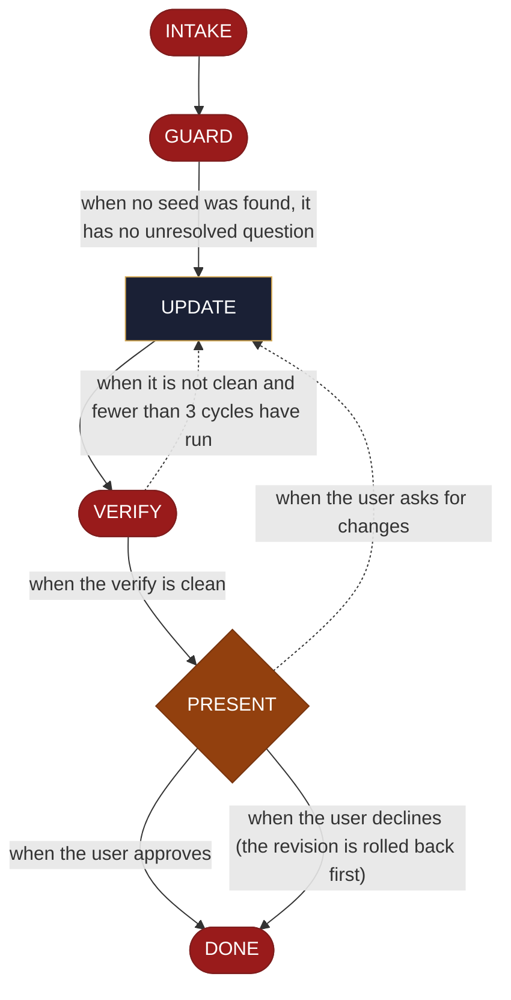

<!-- generated — do not edit; source: canonical/skills/aid-update-mvp/SKILL.md -->

## Frontmatter

- **`name`** — aid-update-mvp
- **`description`** — Revise roadmap.md's ## MVP section only -- the first shippable slice: its contents, the line reasoning, what was cut, and its Status field (including the transition to Shipped &lt;version>). Use this skill when the MVP section already carries committed content and its scope has changed. May create the ## MVP section if roadmap.md exists without one. Reads and consumes an MVP seed when one is present in `.aid/design/`; never requires one. Asks every run which previously created outputs to update alongside it -- no stored list, no tracking metadata written. Everything outside ## MVP belongs to `/aid-update-roadmap`. When roadmap.md is absent, routes to `/aid-create-roadmap` without writing anything.
- **`allowed-tools`** — Read Glob Grep Bash Shell Terminal Write Edit Agent
- **`argument-hint`** — [&lt;slice>] -- what to revise in the MVP section (contents, line, cuts, status)

[Definition: `canonical/skills/aid-update-mvp/SKILL.md`](https://github.com/AndreVianna/aid-methodology/blob/master/canonical/skills/aid-update-mvp/SKILL.md)

## Flow

## Source fragments

Every node in the chart above, in chart order, with the exact `canonical/` text it was derived from.

**1 · `INTAKE`** · _exit_ · HALT

~~~~plaintext title="canonical/skills/aid-update-mvp/SKILL.md#L56-L73" wrap
## State: INTAKE

1. **Require a subject.** Empty argument -> ask one bootstrapping question ("What would
   you like to revise in the MVP section -- slice contents, the line reasoning, cuts, or
   status?") and wait.
2. **Read the destination** at `.aid/knowledge/roadmap.md`. If absent, **route**: allocate nothing and
   write nothing, name `/aid-create-roadmap` explicitly in the response, and end the run.
3. **Read the seed** at `.aid/design/mvp.md` if one exists. Note its presence or absence;
   do not require it.
4. **Ask the derived-outputs question** -- every run, unconditionally: "Which previously
   created outputs should be updated alongside the MVP section?" Wait for the user's
   answer before proceeding. Write no stored list and no tracking metadata anywhere.
5. **Classify complexity (model + effort)** for the `aid-architect` dispatch below;
   verifier tier >= producer tier (`agent-dispatch-tiering.md`).
6. **Allocate** once the destination is present, so a route leaves no work behind, exactly per
   `design-lifecycle.md § Skill shape -- Allocation`: the Work Initiation Gate, with
   `initiator: aid-update-mvp`, `--path lite` and the saved step `GUARD` (INTAKE runs before the
   record and saves nothing), and `--seed .aid/design/mvp.md` on the gate's `--create` when that seed exists (the gate adds it to the work's `sources:` and copies its `## Questions` into the work's record). `phase` is not driven.
~~~~

[Source: `canonical/skills/aid-update-mvp/SKILL.md#L56-L73`](https://github.com/AndreVianna/aid-methodology/blob/master/canonical/skills/aid-update-mvp/SKILL.md#L56-L73) · [full step: `canonical/skills/aid-update-mvp/SKILL.md#L56-L78`](https://github.com/AndreVianna/aid-methodology/blob/master/canonical/skills/aid-update-mvp/SKILL.md#L56-L78)

**2 · `GUARD`** · _exit_ · HALT

~~~~plaintext title="canonical/skills/aid-update-mvp/SKILL.md#L82-L85" wrap
## State: GUARD

**Readiness gate (class-1 contract, feature-002 §3b).** Only applies when a seed was
found in INTAKE.
~~~~

[Source: `canonical/skills/aid-update-mvp/SKILL.md#L82-L85`](https://github.com/AndreVianna/aid-methodology/blob/master/canonical/skills/aid-update-mvp/SKILL.md#L82-L85) · [full step: `canonical/skills/aid-update-mvp/SKILL.md#L82-L95`](https://github.com/AndreVianna/aid-methodology/blob/master/canonical/skills/aid-update-mvp/SKILL.md#L82-L95)

**3 · `UPDATE`** · _step_

~~~~plaintext title="canonical/skills/aid-update-mvp/SKILL.md#L99-L105" wrap
## State: UPDATE

**Before the first edit,** copy every file this step will edit or delete (the destination, each output the user
named in INTAKE, a consumed seed and, for a promotion, `tech-debt.md`) into `rollback/` in the work folder, under the same
relative path, so PRESENT can restore them if the user declines. Copy only once: when UPDATE runs
again (after VERIFY or a requested change), a file already under `rollback/` is kept, so a decline restores
the original, not an earlier revision.
~~~~

[Source: `canonical/skills/aid-update-mvp/SKILL.md#L99-L105`](https://github.com/AndreVianna/aid-methodology/blob/master/canonical/skills/aid-update-mvp/SKILL.md#L99-L105) · [full step: `canonical/skills/aid-update-mvp/SKILL.md#L99-L144`](https://github.com/AndreVianna/aid-methodology/blob/master/canonical/skills/aid-update-mvp/SKILL.md#L99-L144)

**4 · `VERIFY`** · _exit_ · HALT

~~~~plaintext title="canonical/skills/aid-update-mvp/SKILL.md#L148-L152" wrap
## State: VERIFY

**Full verify** -- exactly as `design-lifecycle.md § Skill shape -- "Full verify"`
defines it. Not clean -> loop to UPDATE; the circuit-breaker there governs escalation
to IMPEDIMENT + `lifecycle: Blocked`.
~~~~

[Source: `canonical/skills/aid-update-mvp/SKILL.md#L148-L152`](https://github.com/AndreVianna/aid-methodology/blob/master/canonical/skills/aid-update-mvp/SKILL.md#L148-L152) · [full step: `canonical/skills/aid-update-mvp/SKILL.md#L148-L154`](https://github.com/AndreVianna/aid-methodology/blob/master/canonical/skills/aid-update-mvp/SKILL.md#L148-L154)

**5 · `PRESENT`** — hard stop -- the user decides · _decision_

~~~~plaintext title="canonical/skills/aid-update-mvp/SKILL.md#L158-L161" wrap
## State: PRESENT (hard stop -- the user decides)

Present the revised `## MVP` section clearly.
Assert:
~~~~

[Source: `canonical/skills/aid-update-mvp/SKILL.md#L158-L161`](https://github.com/AndreVianna/aid-methodology/blob/master/canonical/skills/aid-update-mvp/SKILL.md#L158-L161) · [full step: `canonical/skills/aid-update-mvp/SKILL.md#L158-L185`](https://github.com/AndreVianna/aid-methodology/blob/master/canonical/skills/aid-update-mvp/SKILL.md#L158-L185)

**6 · `DONE`** · _exit_ · HALT

~~~~plaintext title="canonical/skills/aid-update-mvp/SKILL.md#L189-L191" wrap
## State: DONE

Set `lifecycle` to `Completed` through the writer (`--pipeline --field Lifecycle --value Completed`), which also clears the saved skill and step.
~~~~

[Source: `canonical/skills/aid-update-mvp/SKILL.md#L189-L191`](https://github.com/AndreVianna/aid-methodology/blob/master/canonical/skills/aid-update-mvp/SKILL.md#L189-L191) · [full step: `canonical/skills/aid-update-mvp/SKILL.md#L189-L193`](https://github.com/AndreVianna/aid-methodology/blob/master/canonical/skills/aid-update-mvp/SKILL.md#L189-L193)
