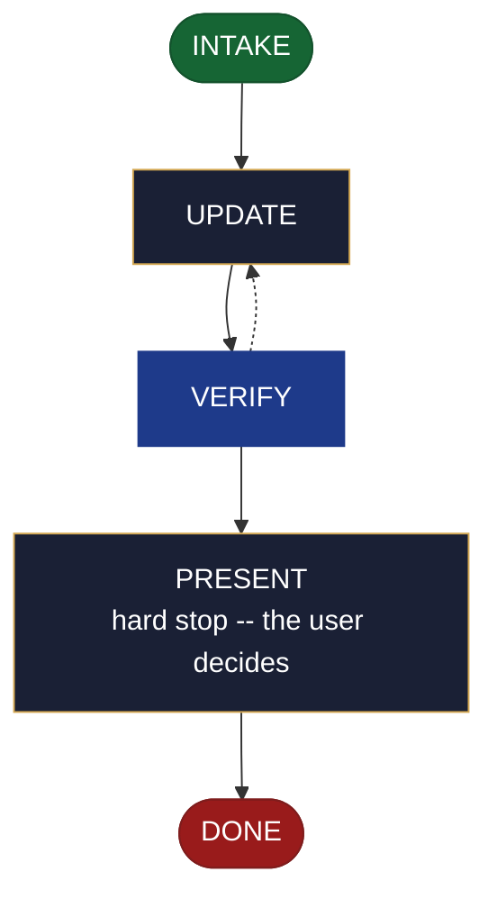

<!-- generated — do not edit; source: canonical/skills/aid-update-stack/SKILL.md -->

## Frontmatter

- **`name`** — aid-update-stack
- **`description`** — Revise the technology-stack KB document. Use when a technology choice changed.
- **`allowed-tools`** — Read Glob Grep Bash Shell Terminal Write Edit Agent
- **`argument-hint`** — &lt;change> -- what to revise in the technology-stack record

[Definition: `canonical/skills/aid-update-stack/SKILL.md`](https://github.com/AndreVianna/aid-methodology/blob/master/canonical/skills/aid-update-stack/SKILL.md)

## Flow

## Source fragments

Every node in the chart above, in chart order, with the exact `canonical/` text it was derived from.

**1 · `INTAKE`** · _entry_

~~~~plaintext title="canonical/skills/aid-update-stack/SKILL.md#L29-L47" wrap
## State: INTAKE

1. **Require a stated change.** Empty argument -> ask one bootstrapping question ("What
   should change in the technology-stack record?") and wait.
2. **Allocate** through the Work Initiation Gate exactly as the contract's Allocation rule
   requires (`.agents/skills/aid-design/SKILL.md` INTAKE step 4 is the shape), with
   `initiator: aid-update-stack`. `phase` is not driven.
3. **No seed is required.** The change stated in this run is a sufficient input, and this
   skill completes without a seed. **Read and consume one when present** at
   `.aid/design/stack.md`, carrying its `## Current direction` into the destination and
   deleting it once realized.
4. **Resolve the destination by concern.** This skill binds concern **C0** (technology). Where
   a seed supplied a `## Destination`, use it; otherwise apply the concern rule here --
   resolve C0 against `.aid/settings.yml` `knowledge.doc_set`, falling back to the C0 row of
   `.aid/runtime/templates/kb-authoring/domain-doc-matrix.md` -- and **confirm the resolution
   with the user before writing**. Never resolve silently.
5. **Read the whole destination**, and note its `source:` field. Absent destination -> route
   to `/aid-create-stack` and write nothing.
6. **Classify complexity** for the `aid-architect` dispatch (verifier tier >= producer).
~~~~

[Source: `canonical/skills/aid-update-stack/SKILL.md#L29-L47`](https://github.com/AndreVianna/aid-methodology/blob/master/canonical/skills/aid-update-stack/SKILL.md#L29-L47) · [full step: `canonical/skills/aid-update-stack/SKILL.md#L29-L49`](https://github.com/AndreVianna/aid-methodology/blob/master/canonical/skills/aid-update-stack/SKILL.md#L29-L49)

**2 · `UPDATE`** · _step_

~~~~plaintext title="canonical/skills/aid-update-stack/SKILL.md#L53-L63" wrap
## State: UPDATE

1. **Apply only the change the user named in this run**, to the owned C0 content, per the
   content rules below.
2. **Ask, every run, which derived outputs to update alongside this one.** This step is
   unconditional -- it runs on every invocation, and the answer is **stored nowhere**: no
   frontmatter backlink, no manifest, no registry, and no state carried between runs. The
   question is asked afresh each time.
3. **Write no tracking metadata** into any output this run touches -- no `derived-from`, no
   `source-doc`, no `generated-by`, no `aid-tracked` field, and no skill-attribution line.
4. **`source: generated` refuses.** A registered build script owns that content.
~~~~

[Source: `canonical/skills/aid-update-stack/SKILL.md#L53-L63`](https://github.com/AndreVianna/aid-methodology/blob/master/canonical/skills/aid-update-stack/SKILL.md#L53-L63) · [full step: `canonical/skills/aid-update-stack/SKILL.md#L53-L65`](https://github.com/AndreVianna/aid-methodology/blob/master/canonical/skills/aid-update-stack/SKILL.md#L53-L65)

**3 · `VERIFY`** · _loop-back_

~~~~plaintext title="canonical/skills/aid-update-stack/SKILL.md#L69-L72" wrap
## State: VERIFY

**Full verify**, as `design-lifecycle.md` defines it. Not clean -> loop to UPDATE; the
3-cycle circuit breaker there escalates to IMPEDIMENT + `lifecycle: Blocked`.
~~~~

[Source: `canonical/skills/aid-update-stack/SKILL.md#L69-L72`](https://github.com/AndreVianna/aid-methodology/blob/master/canonical/skills/aid-update-stack/SKILL.md#L69-L72) · [full step: `canonical/skills/aid-update-stack/SKILL.md#L69-L74`](https://github.com/AndreVianna/aid-methodology/blob/master/canonical/skills/aid-update-stack/SKILL.md#L69-L74)

**4 · `PRESENT`** — hard stop -- the user decides · _step_

~~~~plaintext title="canonical/skills/aid-update-stack/SKILL.md#L78-L81" wrap
## State: PRESENT (hard stop -- the user decides)

Set `lifecycle: Paused-Awaiting-Input`. Present the revision, name every output touched, state
where any rejected alternative went, and assert that a consumed seed is gone.
~~~~

[Source: `canonical/skills/aid-update-stack/SKILL.md#L78-L81`](https://github.com/AndreVianna/aid-methodology/blob/master/canonical/skills/aid-update-stack/SKILL.md#L78-L81) · [full step: `canonical/skills/aid-update-stack/SKILL.md#L78-L83`](https://github.com/AndreVianna/aid-methodology/blob/master/canonical/skills/aid-update-stack/SKILL.md#L78-L83)

**5 · `DONE`** · _exit_ · UNSPECIFIED

~~~~plaintext title="canonical/skills/aid-update-stack/SKILL.md#L87-L89" wrap
## State: DONE

Set `lifecycle: Completed`, `updated` now, append a `## Lifecycle History` row.
~~~~

[Source: `canonical/skills/aid-update-stack/SKILL.md#L87-L89`](https://github.com/AndreVianna/aid-methodology/blob/master/canonical/skills/aid-update-stack/SKILL.md#L87-L89) · [full step: `canonical/skills/aid-update-stack/SKILL.md#L87-L89`](https://github.com/AndreVianna/aid-methodology/blob/master/canonical/skills/aid-update-stack/SKILL.md#L87-L89)
