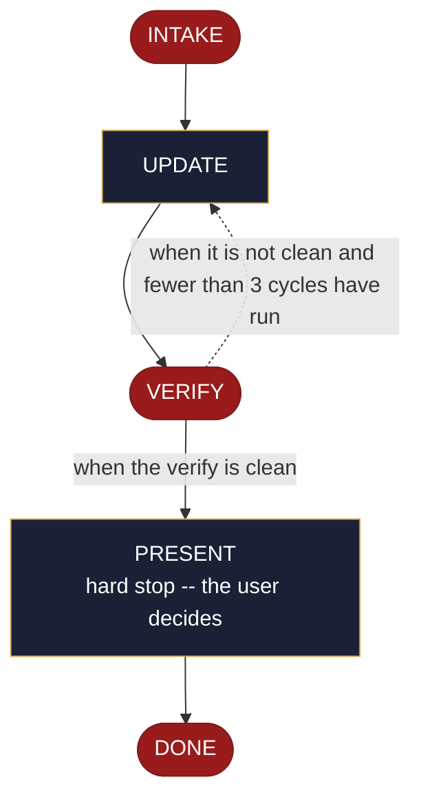

<!-- generated — do not edit; source: canonical/skills/aid-update-testing-strategy/SKILL.md -->

## Frontmatter

- **`name`** — aid-update-testing-strategy
- **`description`** — Revise the project's quality (C6) documents -- the test landscape (levels, coverage expectations, CI lane mapping, known gaps) and the gate policy (what blocks a merge, the thresholds, who may waive one) -- plus any previously created outputs you name. Use this skill when the testing-strategy record already exists and a lane or a gate has changed. Requires no design seed: the change you state in the run is a sufficient input. Reads and consumes a testing-strategy seed when one is present in `.aid/design/`. When a C6 document does not yet exist, routes to `/aid-create-testing-strategy`. To author or revise test CODE rather than the strategy, use `/aid-create-test` or `/aid-update-test`. Produced by the aid-architect agent and independently verified by aid-reviewer (full verify). Allocates a work-NNN folder.
- **`allowed-tools`** — Read Glob Grep Bash Shell Terminal Write Edit Agent
- **`argument-hint`** — &lt;change> -- what to revise in the testing strategy or the gate policy

[Definition: `canonical/skills/aid-update-testing-strategy/SKILL.md`](https://github.com/AndreVianna/aid-methodology/blob/master/canonical/skills/aid-update-testing-strategy/SKILL.md)

## Flow

## Source fragments

Every node in the chart above, in chart order, with the exact `canonical/` text it was derived from.

**1 · `INTAKE`** · _exit_ · HALT

~~~~plaintext title="canonical/skills/aid-update-testing-strategy/SKILL.md#L50-L75" wrap
## State: INTAKE

1. **Require a stated change.** Empty argument -> ask one bootstrapping question ("What should
   change in the testing strategy or the gate policy?") and wait.
2. **No seed is required.** The change stated in this run is a sufficient input, and this
   skill completes without a seed. **Read and consume one when present** at
   `.aid/design/testing-strategy.md`, carrying its `## Current direction` into the
   destinations and deleting it once realized.
3. **Resolve the destinations by concern.** This skill binds concern **C6** (quality &
   testing) and owns **two** documents. Where a seed supplied a `## Destination`, use it;
   otherwise apply the concern rule here -- resolve C6 against `.aid/settings.yml`
   `knowledge.doc_set`, falling back to the C6 row of
   `.aid/runtime/templates/kb-authoring/domain-doc-matrix.md` -- and **confirm the resolution
   with the user before writing**. Never resolve silently.
4. **Read both destinations** whole, and note each one's `source:` field. An absent
   destination is written nothing: tell the user to run `/aid-create-testing-strategy` for that document.
   When neither document exists, allocate nothing and end the run.
5. **Ask, every run, which derived outputs to update alongside this one.** This question is
   unconditional -- it is asked on every invocation, and the answer is **stored nowhere** but this
   run's step detail: no frontmatter backlink, no manifest, no registry, and no state carried
   between runs. The question is asked afresh each time, and UPDATE applies the answer.
6. **Classify complexity** for the `aid-architect` dispatch (verifier tier >= producer).
7. **Allocate** once a destination is present, so a route leaves no work behind. Go through the Work
   Initiation Gate exactly as the contract's Allocation rule requires
   (`.agents/skills/aid-design/SKILL.md` INTAKE step 4 is the shape), with
   `initiator: aid-update-testing-strategy`, saved step `UPDATE` (INTAKE runs before the record and saves nothing). `phase` is not driven.
~~~~

[Source: `canonical/skills/aid-update-testing-strategy/SKILL.md#L50-L75`](https://github.com/AndreVianna/aid-methodology/blob/master/canonical/skills/aid-update-testing-strategy/SKILL.md#L50-L75) · [full step: `canonical/skills/aid-update-testing-strategy/SKILL.md#L50-L80`](https://github.com/AndreVianna/aid-methodology/blob/master/canonical/skills/aid-update-testing-strategy/SKILL.md#L50-L80)

**2 · `UPDATE`** · _step_

~~~~plaintext title="canonical/skills/aid-update-testing-strategy/SKILL.md#L84-L91" wrap
## State: UPDATE

1. **Apply only the change the user named in this run**, to the owned C6 content, per the
   content rules below.
2. **Update the derived outputs the user named in INTAKE**, and only those, each by the same rules.
3. **Write no tracking metadata** into any output this run touches -- no `derived-from`, no
   `source-doc`, no `generated-by`, no `aid-tracked` field, and no skill-attribution line.
4. **`source: generated` refuses.** A registered build script owns that content.
~~~~

[Source: `canonical/skills/aid-update-testing-strategy/SKILL.md#L84-L91`](https://github.com/AndreVianna/aid-methodology/blob/master/canonical/skills/aid-update-testing-strategy/SKILL.md#L84-L91) · [full step: `canonical/skills/aid-update-testing-strategy/SKILL.md#L84-L93`](https://github.com/AndreVianna/aid-methodology/blob/master/canonical/skills/aid-update-testing-strategy/SKILL.md#L84-L93)

**3 · `VERIFY`** · _exit_ · HALT

~~~~plaintext title="canonical/skills/aid-update-testing-strategy/SKILL.md#L97-L100" wrap
## State: VERIFY

**Full verify**, as `design-lifecycle.md` defines it. Not clean -> loop to UPDATE; the
3-cycle circuit breaker there escalates to IMPEDIMENT + `lifecycle: Blocked`.
~~~~

[Source: `canonical/skills/aid-update-testing-strategy/SKILL.md#L97-L100`](https://github.com/AndreVianna/aid-methodology/blob/master/canonical/skills/aid-update-testing-strategy/SKILL.md#L97-L100) · [full step: `canonical/skills/aid-update-testing-strategy/SKILL.md#L97-L102`](https://github.com/AndreVianna/aid-methodology/blob/master/canonical/skills/aid-update-testing-strategy/SKILL.md#L97-L102)

**4 · `PRESENT`** — hard stop -- the user decides · _step_

~~~~plaintext title="canonical/skills/aid-update-testing-strategy/SKILL.md#L106-L109" wrap
## State: PRESENT (hard stop -- the user decides)

Set `lifecycle` to `Paused-Awaiting-Input` through the writer. Present the revision, say which C6 half each change
went to, name every output touched, and assert that a consumed seed is gone.
~~~~

[Source: `canonical/skills/aid-update-testing-strategy/SKILL.md#L106-L109`](https://github.com/AndreVianna/aid-methodology/blob/master/canonical/skills/aid-update-testing-strategy/SKILL.md#L106-L109) · [full step: `canonical/skills/aid-update-testing-strategy/SKILL.md#L106-L111`](https://github.com/AndreVianna/aid-methodology/blob/master/canonical/skills/aid-update-testing-strategy/SKILL.md#L106-L111)

**5 · `DONE`** · _exit_ · HALT

~~~~plaintext title="canonical/skills/aid-update-testing-strategy/SKILL.md#L115-L117" wrap
## State: DONE

Set `lifecycle` to `Completed` through the writer (`--pipeline --field Lifecycle --value Completed`), which also clears the saved skill and step.
~~~~

[Source: `canonical/skills/aid-update-testing-strategy/SKILL.md#L115-L117`](https://github.com/AndreVianna/aid-methodology/blob/master/canonical/skills/aid-update-testing-strategy/SKILL.md#L115-L117) · [full step: `canonical/skills/aid-update-testing-strategy/SKILL.md#L115-L119`](https://github.com/AndreVianna/aid-methodology/blob/master/canonical/skills/aid-update-testing-strategy/SKILL.md#L115-L119)
