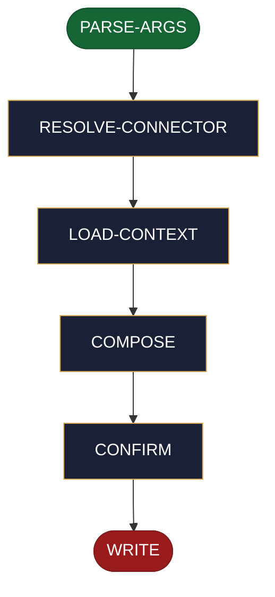

<!-- generated — do not edit; source: canonical/skills/aid-update-ticket/SKILL.md -->

## Frontmatter

- **`name`** — aid-update-ticket
- **`description`** — Change one part of a ticket: description, comment or status. Use to update a tracker ticket.
- **`allowed-tools`** — Read Glob Grep AskUserQuestion
- **`argument-hint`** — &lt;part> [&lt;connector>:]&lt;ticket-id> &lt;content>

[Definition: `canonical/skills/aid-update-ticket/SKILL.md`](https://github.com/AndreVianna/aid-methodology/blob/master/canonical/skills/aid-update-ticket/SKILL.md)

## Flow

> **Approximate:** This chart is derived by heuristic; exact transitions may differ from runtime behaviour.

## Source fragments

Every node in the chart above, in chart order, with the exact `canonical/` text it was derived from.

**1 · `PARSE-ARGS`** · _entry_

~~~~plaintext title="canonical/skills/aid-update-ticket/SKILL.md#L54" wrap
### State 1 — PARSE-ARGS
~~~~

[Source: `canonical/skills/aid-update-ticket/SKILL.md#L54`](https://github.com/AndreVianna/aid-methodology/blob/master/canonical/skills/aid-update-ticket/SKILL.md#L54)

**2 · `RESOLVE-CONNECTOR`** · _step_

~~~~plaintext title="canonical/skills/aid-update-ticket/SKILL.md#L66" wrap
### State 2 — RESOLVE-CONNECTOR
~~~~

[Source: `canonical/skills/aid-update-ticket/SKILL.md#L66`](https://github.com/AndreVianna/aid-methodology/blob/master/canonical/skills/aid-update-ticket/SKILL.md#L66)

**3 · `LOAD-CONTEXT`** · _step_

~~~~plaintext title="canonical/skills/aid-update-ticket/SKILL.md#L76" wrap
### State 3 — LOAD-CONTEXT
~~~~

[Source: `canonical/skills/aid-update-ticket/SKILL.md#L76`](https://github.com/AndreVianna/aid-methodology/blob/master/canonical/skills/aid-update-ticket/SKILL.md#L76)

**4 · `COMPOSE`** · _step_

~~~~plaintext title="canonical/skills/aid-update-ticket/SKILL.md#L95" wrap
### State 4 — COMPOSE
~~~~

[Source: `canonical/skills/aid-update-ticket/SKILL.md#L95`](https://github.com/AndreVianna/aid-methodology/blob/master/canonical/skills/aid-update-ticket/SKILL.md#L95)

**5 · `CONFIRM`** · _step_

~~~~plaintext title="canonical/skills/aid-update-ticket/SKILL.md#L119" wrap
### State 5 — CONFIRM
~~~~

[Source: `canonical/skills/aid-update-ticket/SKILL.md#L119`](https://github.com/AndreVianna/aid-methodology/blob/master/canonical/skills/aid-update-ticket/SKILL.md#L119)

**6 · `WRITE`** · _exit_ · UNSPECIFIED

~~~~plaintext title="canonical/skills/aid-update-ticket/SKILL.md#L145" wrap
### State 6 — WRITE
~~~~

[Source: `canonical/skills/aid-update-ticket/SKILL.md#L145`](https://github.com/AndreVianna/aid-methodology/blob/master/canonical/skills/aid-update-ticket/SKILL.md#L145)
